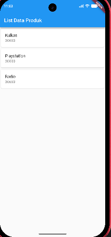

# Tugas Praktikum Pemrograman Mobile - Modul 2

Repository ini berisi kumpulan tugas dan latihan praktikum Modul 2 mata kuliah Pemrograman Mobile menggunakan bahasa pemrograman **Dart** dan framework **Flutter**.

---

## Identitas Mahasiswa
* **Nama** : Mohamad Ilham Huda Saputra
* **NIM** : H1D024126
* **Shift/Kelas** : Shift B

---

## Preview Aplikasi
<p align="center">
  
  <br>
  <em>Tampilan Hasil Praktikum Flutter (List Data Produk)</em>
</p>

---

## Daftar Isi
1. [Bagian 1: Implementasi Struktur Data Queue (Dart)](#bagian-1-implementasi-struktur-data-queue-dart)
2. [Bagian 2: Implementasi Flutter (belajarflutter/)](#bagian-2-implementasi-flutter-belajarflutter)

---

## Bagian 1: Implementasi Struktur Data Queue (Dart)

Implementasi struktur data **Queue (Antrian)** berbasis konsep **FIFO (First In, First Out)** menggunakan bahasa pemrograman Dart (`queue.dart`).

### Deskripsi Singkat
Struktur data **Queue** adalah kumpulan elemen terurut di mana penambahan elemen baru dilakukan di bagian belakang (*tail*) dan pengambilan/penghapusan elemen dilakukan di bagian depan (*head*). Konsep ini mengikuti prinsip **FIFO (First In, First Out)**, yaitu elemen yang pertama kali dimasukkan akan menjadi elemen yang pertama kali dikeluarkan.

### Penjelasan Kode (`queue.dart`)
1. **Kelas `Queue`**
   * Menggunakan variabel *private list* `_antrian` bertipe integer (`List<int>`) untuk menyimpan data antrian.
2. **Metode `enqueue(int data)`**
   * Menambahkan data baru ke urutan paling belakang list menggunakan `_antrian.add(data)`.
   * Menampilkan pesan konfirmasi bahwa data berhasil ditambahkan.
3. **Metode `pop()`**
   * Mengecek apakah antrian kosong via `_antrian.isEmpty`. Jika kosong, menampilkan pesan peringatan dan mengembalikan nilai `null`.
   * Jika ada isi, mengambil dan menghapus elemen indeks pertama menggunakan `_antrian.removeAt(0)` sesuai konsep FIFO.
   * Menampilkan pesan konfirmasi data yang dihapus.
4. **Metode `cetakAntrian()`**
   * Menampilkan daftar isi elemen antrian saat ini ke konsol.
5. **Fungsi `main()`**
   * Menginisialisasi objek `Queue`.
   * Menjalankan operasi antrian: memasukkan data 10, 20, 30 (`enqueue`), mencetak status antrian, menghapus elemen terdepan (`pop`), dan mencetak sisa antrian kembali.

### Cara Menjalankan Program
Buka terminal pada root repositori dan jalankan:
```bash
dart run queue.dart
```

**Output Program:**
```plaintext
10 berhasil ditambahkan ke antrian
20 berhasil ditambahkan ke antrian
30 berhasil ditambahkan ke antrian
Isi antrian: [10, 20, 30]
10 dihapus dari antrian
Isi antrian: [20, 30]
```

---

## Bagian 2: Implementasi Flutter (`belajarflutter/`)

Implementasi tugas dan latihan praktikum Modul 2 Pemrograman Mobile menggunakan framework Flutter yang berada di dalam folder `belajarflutter/`.

### Latihan yang Diimplementasikan:
1. **Hello World (`belajarflutter/lib/hello_world.dart`)**:
   * Dasar pembuatan tampilan menggunakan `StatelessWidget`, `Scaffold`, `AppBar`, dan `Center`.
2. **Column Widget (`belajarflutter/lib/column_widget.dart`)**:
   * Penataan komponen tata letak (layout) secara vertikal menggunakan `Column`.
3. **Row Widget (`belajarflutter/lib/row_widget.dart`)**:
   * Penataan komponen tata letak secara horizontal menggunakan `Row`.
4. **Form Produk & Detail (`belajarflutter/lib/ui/produk_form.dart` & `belajarflutter/lib/ui/produk_detail.dart`)**:
   * Input data kode produk, nama produk, dan harga produk menggunakan `TextField` dan `StatefulWidget`.
   * Perpindahan halaman dan pengiriman data objek menggunakan `Navigator.push` ke halaman detail produk.
5. **List Data Produk (`belajarflutter/lib/ui/produk_page.dart`)**:
   * Menampilkan daftar item produk dalam bentuk list menggunakan `ListView`, `Card`, dan `ListTile`.

### Display Aplikasi
<p align="center">
  
</p>

### Cara Menjalankan Aplikasi Flutter:
1. Masuk ke direktori proyek Flutter:
   ```bash
   cd belajarflutter
   ```
2. Unduh *dependencies*:
   ```bash
   flutter pub get
   ```
3. Jalankan aplikasi (pilih device / emulator / chrome):
   ```bash
   flutter run
   ```
