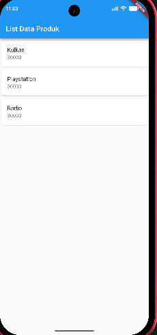

# Tugas Praktikum Pemrograman Mobile

Repository ini berisi kumpulan tugas dan latihan praktikum mata kuliah **Pemrograman Mobile** menggunakan bahasa pemrograman **Dart**, framework **Flutter**, serta backend RESTful API **CodeIgniter 4**.

---

## 👤 Identitas Mahasiswa

| Keterangan | Data Mahasiswa |
| :--- | :--- |
| **Nama** | Mohamad Ilham Huda Saputra |
| **NIM** | H1D024126 |
| **Shift / Kelas** | Shift B |
| **Program Studi** | Informatika |

---

## 📌 Daftar Isi
1. [Bagian 1: Struktur Data Queue (Dart)](#-bagian-1-struktur-data-queue-dart)
2. [Bagian 2: Implementasi Dasar Flutter (`belajarflutter/`)](#-bagian-2-implementasi-dasar-flutter-belajarflutter)
3. [Bagian 3: Routing, Sidemenu, & Shared Preferences (`router_flutter/`)](#-bagian-3-routing-sidemenu--shared-preferences-router_flutter)
4. [Bagian 4: Operasi CRUD Produk (Tambah, Ubah, Hapus)](#-bagian-4-operasi-crud-produk-tambah-ubah-hapus)
5. [Bagian 5: Integrasi REST API, Autentikasi, & Backend CI4 (`tokokita/` & `toko-api/`)](#-bagian-5-integrasi-rest-api-autentikasi--backend-ci4)

---

## 🔹 Bagian 1: Struktur Data Queue (Dart)

Implementasi struktur data **Queue (Antrian)** berbasis konsep **FIFO (First In, First Out)** menggunakan bahasa pemrograman Dart (`queue.dart`).

### Deskripsi Singkat
Struktur data **Queue** adalah kumpulan elemen terurut di mana penambahan elemen baru dilakukan di bagian belakang (*tail*) dan pengambilan/penghapusan elemen dilakukan di bagian depan (*head*). Konsep ini mengikuti prinsip **FIFO (First In, First Out)**, yaitu elemen yang pertama kali dimasukkan akan menjadi elemen yang pertama kali dikeluarkan.

### Penjelasan Kode (`queue.dart`)
1. **Kelas `Queue`**
   * Menggunakan variabel *private list* `_antrian` bertipe integer (`List<int>`) untuk menyimpan data antrian.
2. **Metode `enqueue(int data)`**
   * Menambahkan data baru ke urutan paling belakang list menggunakan `_antrian.add(data)`.
   * Menampilkan pesan konfirmasi bahwa data berhasil ditambahkan.
3. **Metode `pop()`**
   * Mengecek apakah antrian kosong via `_antrian.isEmpty`. Jika kosong, menampilkan pesan peringatan dan mengembalikan nilai `null`.
   * Jika ada isi, mengambil dan menghapus elemen indeks pertama menggunakan `_antrian.removeAt(0)` sesuai konsep FIFO.
   * Menampilkan pesan konfirmasi data yang dihapus.
4. **Metode `cetakAntrian()`**
   * Menampilkan daftar isi elemen antrian saat ini ke konsol.
5. **Fungsi `main()`**
   * Menginisialisasi objek `Queue`.
   * Menjalankan operasi antrian: memasukkan data 10, 20, 30 (`enqueue`), mencetak status antrian, menghapus elemen terdepan (`pop`), dan mencetak sisa antrian kembali.

### Cara Menjalankan Program
Buka terminal pada root repositori dan jalankan:
```bash
dart run queue.dart
```

**Output Program:**
```plaintext
10 berhasil ditambahkan ke antrian
20 berhasil ditambahkan ke antrian
30 berhasil ditambahkan ke antrian
Isi antrian: [10, 20, 30]
10 dihapus dari antrian
Isi antrian: [20, 30]
```

---

## 🔹 Bagian 2: Implementasi Dasar Flutter (`belajarflutter/`)

Implementasi tugas dan latihan praktikum Pemrograman Mobile menggunakan framework Flutter yang berada di dalam folder `belajarflutter/`.

### Latihan yang Diimplementasikan:
1. **Hello World (`belajarflutter/lib/hello_world.dart`)**:
   * Dasar pembuatan tampilan menggunakan `StatelessWidget`, `Scaffold`, `AppBar`, dan `Center`.
2. **Column Widget (`belajarflutter/lib/column_widget.dart`)**:
   * Penataan komponen tata letak (*layout*) secara vertikal menggunakan `Column`.
3. **Row Widget (`belajarflutter/lib/row_widget.dart`)**:
   * Penataan komponen tata letak secara horizontal menggunakan `Row`.
4. **Form Produk & Detail (`belajarflutter/lib/ui/produk_form.dart` & `belajarflutter/lib/ui/produk_detail.dart`)**:
   * Input data kode produk, nama produk, dan harga produk menggunakan `TextField` dan `StatefulWidget`.
   * Perpindahan halaman dan pengiriman data objek menggunakan `Navigator.push` ke halaman detail produk.
5. **List Data Produk (`belajarflutter/lib/ui/produk_page.dart`)**:
   * Menampilkan daftar item produk dalam bentuk list menggunakan `ListView`, `Card`, dan `ListTile`.

### 📱 Tampilan Hasil Praktikum
<p align="center">
  
  <br>
  <em>Tampilan List Data Produk (belajarflutter)</em>
</p>

### Cara Menjalankan:
```bash
cd belajarflutter
flutter pub get
flutter run
```

---

## 🔹 Bagian 3: Routing, Sidemenu, & Shared Preferences (`router_flutter/`)

Implementasi tugas praktikum Pemrograman Mobile yang mencakup pengelolaan rute navigasi antar halaman, menu bilah samping (*Navigation Drawer / Sidemenu*), serta persistensi data sesi login menggunakan **`shared_preferences`**.

### Fitur yang Diimplementasikan:
1. **Halaman Login (`router_flutter/lib/login_page.dart`)**:
   * Input teks Username dan Password (`obscureText: true`).
   * Validasi login (akun demo: username `admin` dan password `admin`).
   * Dialog interaktif (`AlertDialog`) konfirmasi login berhasil atau gagal.
   * Penyimpanan username ke local storage via `SharedPreferences`.
2. **Halaman Home (`router_flutter/lib/home_page.dart`)**:
   * Mengambil dan menampilkan nama user secara dinamis dari `SharedPreferences`.
   * Terintegrasi dengan drawer navigasi (*Sidemenu*).
3. **Halaman About (`router_flutter/lib/about_page.dart`)**:
   * Halaman informasi statis yang dapat diakses melalui drawer menu.
4. **Menu Bilah Samping / Drawer (`router_flutter/lib/sidemenu.dart`)**:
   * Widget `Drawer` yang menghubungkan halaman Home dan About menggunakan `Navigator.push` dan `MaterialPageRoute`.

### 🎬 Video Demonstrasi Routing & Session
https://github.com/user-attachments/assets/edc75c85-87eb-4a9c-b0dc-b2914beb90a9

🎬 **[Putar Video Demo (demo.mp4)](https://github.com/Ham171105/Praktikum-Pemmob2-Dart/blob/main/router_flutter/demo/demo.mp4)**

### Cara Menjalankan:
```bash
cd router_flutter
flutter pub get
flutter run
```

---

## 🔹 Bagian 4: Operasi CRUD Produk (Tambah, Ubah, Hapus)

Implementasi operasi **CRUD (Create, Read, Update, Delete)** untuk pengelolaan katalog produk pada aplikasi mobile `tokokita`, mencakup perancangan model data produk, pembuatan antarmuka formulir, navigasi rincian, hingga mekanisme dialog konfirmasi.

### 🎬 Video Demonstrasi CRUD Produk (Tambah, Ubah, Hapus)
https://github.com/user-attachments/assets/e106de1c-15ff-4771-96f7-742235653cb0

### Fitur CRUD yang Diimplementasikan:
1. **Model Data Produk (`model/produk.dart`)**:
   * Kelas model `Produk` dengan atribut `id`, `kodeProduk`, `namaProduk`, dan `hargaProduk`.
   * Dilengkapi factory method `fromJson` untuk pemetaan data objek secara aman.
2. **List Data Produk / Read (`ui/produk_page.dart`)**:
   * Menampilkan daftar seluruh produk dalam antarmuka `ListView` dengan widget `Card` dan `ListTile`.
   * Dilengkapi tombol navigasi tambah produk (`+`) pada bagian AppBar.
3. **Tambah Produk / Create (`ui/produk_form.dart`)**:
   * Formulir input untuk memasukkan **Kode Produk**, **Nama Produk**, dan **Harga**.
   * Validasi input sebelum proses penyimpanan data.
4. **Detail Produk (`ui/produk_detail.dart`)**:
   * Menampilkan informasi rincian produk yang dipilih dari daftar list.
   * Menyediakan dua tombol aksi utama: **EDIT** (Ubah) dan **DELETE** (Hapus).
5. **Ubah Data Produk / Update (`ui/produk_form.dart`)**:
   * Formulir dinamis yang otomatis terisi dengan data produk lama saat mode edit aktif.
   * Menyimpan pembaruan informasi produk kembali ke sistem.
6. **Hapus / Buang Produk / Delete (`ui/produk_detail.dart`)**:
   * Mekanisme penghapusan data yang dilengkapi konfirmasi dialog (`AlertDialog`) dengan opsi **Ya** dan **Batal** untuk mencegah data terhapus secara tidak sengaja.

### Cara Menjalankan:
```bash
cd tokokita
flutter pub get
flutter run
```

---

## 🔹 Bagian 5: Integrasi REST API, Autentikasi, & Backend CI4

Implementasi integrasi aplikasi mobile Flutter `tokokita` dengan backend RESTful API **CodeIgniter 4** (`toko-api`) dan database **MySQL** `toko_api` menggunakan arsitektur **BLoC**, HTTP client Bearer Token, manajemen sesi `shared_preferences`, penanganan exception kustom, serta dialog notifikasi.

### 🎬 Video Demonstrasi Autentikasi & Integrasi REST API
https://github.com/user-attachments/assets/ed632c09-803a-4ca7-8a2e-b54898852291

### 1. Frontend Mobile Toko Kita (`tokokita/`):
* **Helpers (`lib/helpers/`)**:
  * `UserInfo` (`user_info.dart`): Pengelolaan sesi login via SharedPreferences (`token`, `userID`, `logout`).
  * `Api` (`api.dart`): Wrapper HTTP client untuk request POST, GET, DELETE dengan otomatis menyertakan header `Authorization: Bearer <token>` dan validasi status code.
  * `ApiUrl` (`api_url.dart`): Konfigurasi endpoint REST API (`http://10.0.2.2/toko-api/public`).
  * `AppException` (`app_exception.dart`): Kelas exception kustom (`FetchDataException`, `BadRequestException`, `UnauthorisedException`, `InvalidInputException`).
* **BLoC (`lib/bloc/`)**:
  * `RegistrasiBloc`, `LoginBloc`, `LogoutBloc`, dan `ProdukBloc` sebagai pemisah logika bisnis dengan UI.
* **UI & Dialog (`lib/ui/` & `lib/widget/`)**:
  * `RegistrasiPage`: Halaman registrasi akun baru dengan validasi form (Nama min 3 karakter, format email regex, password min 6 karakter).
  * `LoginPage`: Halaman autentikasi login terhubung ke backend API.
  * `SuccessDialog` & `WarningDialog`: Dialog kustom notifikasi hasil operasi.

### 2. Backend Service REST API (`toko-api/`):
File dump SQL database disertakan pada [toko_api.sql](file:///C:/Users/Ilham/AndroidStudioProjects/Praktikum-Pemmob2-Dart/toko-api/toko_api.sql).

* **Database `toko_api`**:
  * Tabel `member` (`id`, `nama`, `email`, `password` via `password_hash`).
  * Tabel `member_token` (`id`, `member_id`, `auth_key`).
  * Tabel `produk` (`id`, `kode_produk`, `nama_produk`, `harga`).
* **Controllers CodeIgniter 4**:
  * `RestfulController.php`: Base controller format JSON dengan method `responseHasil($code, $status, $data)`.
  * `RegistrasiController.php`: Endpoint `POST /registrasi`.
  * `LoginController.php`: Endpoint `POST /login` dengan verifikasi `password_verify` dan token acak `RandomString()`.
  * `ProdukController.php`: Endpoint CRUD produk lengkap (`GET`, `POST`, `PUT`, `DELETE`).

### Cara Menjalankan Backend & Frontend:
1. **Jalankan Backend**:
   Pastikan web server Apache & MySQL (Laragon / XAMPP) sudah berjalan.
   ```bash
   mysql -u root -e "CREATE DATABASE IF NOT EXISTS toko_api;"
   mysql -u root toko_api < toko-api/toko_api.sql
   ```
2. **Jalankan Aplikasi Flutter**:
   ```bash
   cd tokokita
   flutter pub get
   flutter run
   ```
