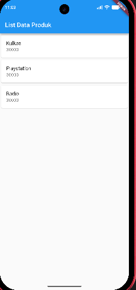

# Tugas Praktikum Pemrograman Mobile - Modul 2 (Flutter)

## Identitas Mahasiswa
- **Nama :** Mohamad Ilham Huda Saputra
- **NIM :** H1D024126
- **Shift/Kelas :** Shift B

---

## IMPLEMENTASI FLUTTER

Implementasi tugas dan latihan praktikum Modul 2 Pemrograman Mobile menggunakan framework Flutter pada direktori `belajarflutter/`.

**Latihan yang diimplementasikan:**

1. **Hello World (`lib/hello_world.dart`)**: Dasar pembuatan tampilan dengan `StatelessWidget`, `Scaffold`, dan `Center`.
2. **Column Widget (`lib/column_widget.dart`)**: Penataan tata letak (layout) secara vertikal (`Column`).
3. **Row Widget (`lib/row_widget.dart`)**: Penataan tata letak secara horizontal (`Row`).
4. **Form Produk & Detail (`lib/ui/produk_form.dart` & `lib/ui/produk_detail.dart`)**: Input data produk (`TextField`), `StatefulWidget`, serta perpindahan halaman dan pengiriman data menggunakan `Navigator.push`.
5. **List Data Produk (`lib/ui/produk_page.dart`)**: Menampilkan daftar item menggunakan `ListView`, `Card`, dan `ListTile`.

### Display Aplikasi
<p align="center">
  
</p>

---

## Cara Menjalankan

1. Pastikan Flutter SDK sudah terpasang dan jalankan:
   ```bash
   flutter pub get
   ```
2. Jalankan aplikasi pada emulator atau perangkat yang terhubung:
   ```bash
   flutter run
   ```
