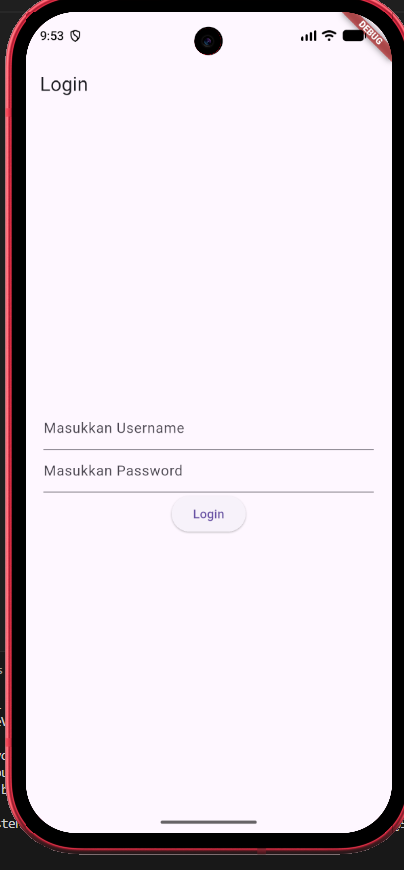

# Tugas Praktikum Pemrograman Mobile - Routing & Shared Preferences (Flutter)

## Identitas Mahasiswa
- **Nama :** Mohamad Ilham Huda Saputra
- **NIM :** H1D024126
- **Shift/Kelas :** Shift B

---

## Deskripsi Proyek

Aplikasi **`router_flutter`** merupakan implementasi tugas praktikum Pemrograman Mobile yang mencakup pengelolaan rute (*routing*), navigasi antar halaman, menu bilah samping (*Navigation Drawer / Sidemenu*), serta persistensi data sesi login menggunakan **`shared_preferences`**.

---

## Display & Demonstrasi Aplikasi

### Tampilan Halaman Login
<p align="center">
  
</p>

### Video Demo Aplikasi
Demonstrasi alur login (sukses & gagal), penyimpanan sesi username ke local storage, dan navigasi sidemenu ke Home Page & About Page dapat dilihat pada video berikut:

🎬 **[Lihat / Download Video Demonstrasi (demo/demo.mp4)](demo/demo.mp4)**

<p align="center">
  <video src="demo/demo.mp4" width="300" controls></video>
</p>

---

## Fitur dan Halaman yang Diimplementasikan

1. **Halaman Login (`lib/login_page.dart`)**:
   * Input teks untuk Username dan Password (`obscureText: true`).
   * Validasi login (akun demo: username `admin` dan password `admin`).
   * Notifikasi berbasis `AlertDialog` saat login berhasil atau gagal.
   * Penyimpanan username ke local storage secara asinkron menggunakan `SharedPreferences.getInstance()` dan `prefs.setString('username', ...)`.

2. **Halaman Home (`lib/home_page.dart`)**:
   * Mengambil username yang telah tersimpan dari local storage via `prefs.getString('username')`.
   * Menampilkan pesan sambutan selamat datang untuk user aktif secara dinamis.
   * Terintegrasi dengan bilah samping (`Drawer: Sidemenu()`).

3. **Halaman About (`lib/about_page.dart`)**:
   * Halaman informasi statis dengan drawer menu untuk navigasi kembali ke Home.

4. **Menu Bilah Samping (`lib/sidemenu.dart`)**:
   * Menggunakan widget `Drawer` dan `ListView`.
   * Berisi `ListTile` navigasi ke halaman **Home** dan **About** menggunakan `Navigator.push` dengan `MaterialPageRoute`.

---

## Cara Menjalankan

1. Pastikan Flutter SDK sudah terpasang, lalu unduh dependencies:
   ```bash
   flutter pub get
   ```
2. Jalankan aplikasi pada emulator atau perangkat yang terhubung:
   ```bash
   flutter run
   ```
